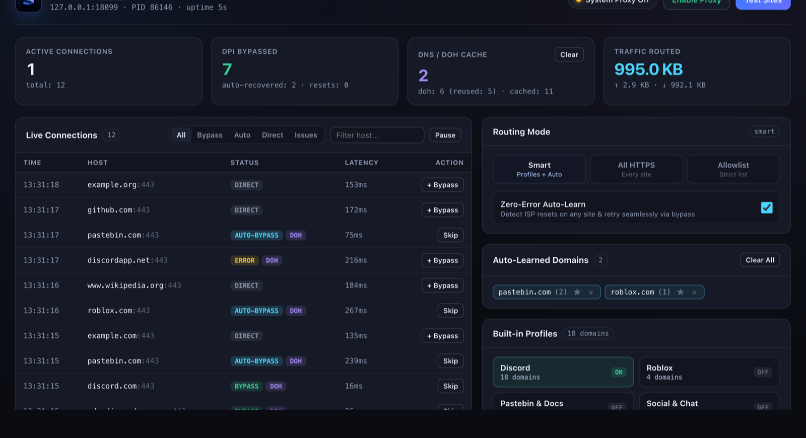

<p align="center">
  
</p>

<h1 align="center">Swerve</h1>

<p align="center">
  A small, fast DPI bypass proxy for macOS, written in Rust.<br/>
  Gets Discord (and other filtered sites) working again without a VPN.
</p>

<p align="center">
  <a href="README.tr.md">Türkçe</a> ·
  <a href="#install">Install</a> ·
  <a href="#usage">Usage</a> ·
  <a href="#how-it-works">How it works</a> ·
  <a href="#configuration">Configuration</a>
</p>

<p align="center">
  
</p>

---

## What is this?

Some ISPs block sites like Discord with **Deep Packet Inspection (DPI)**. When your computer opens an HTTPS connection, the very first packet it sends (the TLS `ClientHello`) contains the site's name in plain text (the SNI field). A DPI box on the ISP's network reads that name and, if it is on a blocklist, kills the connection with a forged TCP reset. That's why the browser shows `ERR_CONNECTION_RESET` and `curl` fails with exit code 35.

Swerve runs as a local proxy on your Mac (`127.0.0.1:18080`) and sets itself as the macOS system proxy. For blocked sites it:

1. **Resolves the name over DNS-over-HTTPS** (Cloudflare / Google by IP), so a poisoned ISP DNS answer can't send you to a dead address.
2. **Reshapes the `ClientHello`** so the DPI box can't read the hostname in one piece: it splits it across several TLS records and/or tiny TCP segments. The real server reassembles it fine; the cheap pattern-matcher in the middle doesn't.

Nothing is decrypted, there's no certificate to install, and no traffic leaves your machine except to the site you're actually visiting. It is **not a VPN**: your IP stays the same, and sites that aren't blocked go out directly, untouched.

### Highlights

- **Smart mode with auto-learn.** Sites in your enabled profiles get the bypass. Any *other* site that gets reset by DPI is retried with the bypass on the same request and remembered, so you don't have to maintain a list.
- **Several desync strategies:** `combo` (default), `tls-record`, `chunk`, `sni-split`, plus optional low-TTL decoy packets. `swerve test --probe` tells you which ones work on your network.
- **Built-in DoH resolver** in pure Rust, with keep-alive connections and TTL caching.
- **Made for macOS.** Configures the proxy on every network service (Wi-Fi, Ethernet, USB tethering, Tailscale), keeps local/LAN/Tailscale addresses direct, follows network changes, and runs as a LaunchAgent so it starts at login.
- **Live web dashboard** at `http://127.0.0.1:18080/ui`: connection feed, one-click bypass/exclude, profile toggles, strategy tuning, and a connectivity test.
- **Tiny.** One ~3 MB binary, ~15 MB RAM, near-zero CPU.

## Requirements

- macOS (tested on macOS 27, Apple Silicon)
- Rust 1.85+ to build (`rustup` / `brew install rust`)
- Your user must be allowed to change network settings (any admin account)

## Install

```bash
git clone https://github.com/yyamandevrim/swerve.git
cd swerve
cargo build --release
cp target/release/swerve ~/.cargo/bin/     # or anywhere on your $PATH
swerve install
```

`swerve install`:

- writes `~/.config/swerve/config.toml` (Discord profile on by default),
- installs and starts the LaunchAgent `~/Library/LaunchAgents/dev.swerve.agent.plist` (starts at login, restarted if it crashes),
- turns on the HTTP + HTTPS system proxy `127.0.0.1:18080` on all network services, with local, LAN and Tailscale addresses excluded.

Then **quit and reopen Discord** (⌘Q) so it picks up the proxy. That's it.

Check that it works:

```bash
swerve test
```

```
=== Direct proxy test (http://127.0.0.1:18080) ===
  https://discord.com            -> HTTP 200 (exit:0) (222ms)
  https://gateway.discord.gg     -> HTTP 404 (exit:0) (264ms)   # 404 is normal here
  ...
```

## Usage

### Everyday commands

| Command | What it does |
|---|---|
| `swerve status` | Service state, live counters, current macOS proxy settings |
| `swerve ui` | Opens the web dashboard |
| `swerve stop` | Turns off the system proxy and stops the service |
| `swerve start` | Starts the service and turns the system proxy back on |
| `swerve restart` | Reinstalls the LaunchAgent (use after replacing the binary) |
| `swerve test` | Tests Discord & a few other sites through the proxy |
| `swerve test --url site.com` | Tests specific sites |
| `swerve test --probe` | Benchmarks every strategy against Discord on your network |
| `swerve uninstall` | Turns off the proxy and removes the LaunchAgent |

### Choosing what gets bypassed

```bash
swerve mode smart          # profiles + your domains + auto-learn (default)
swerve mode list           # only profiles + your domains, nothing learned
swerve mode all            # bypass every HTTPS site

swerve profiles list
swerve profiles enable roblox
swerve profiles disable roblox

swerve domains add example.com        # always bypass (includes subdomains)
swerve domains remove example.com
swerve domains exclude mybank.com     # never touch, always direct
swerve domains unexclude mybank.com
swerve domains list
```

These commands edit `config.toml` and hot-reload the running service; nothing is dropped.

Built-in profiles:

| Profile | Covers |
|---|---|
| `discord` | Discord app, gateway, CDN, media, updates, attachments (on by default) |
| `roblox` | Roblox web, client, CDN |
| `pastebin` | Pastebin, Imgur, Wattpad |
| `social` | Instagram, X/Twitter, Telegram web, Reddit |
| `gaming` | Twitch, Kick, Steam Community |
| `dev` | Wikipedia, Archive.org, Medium, SoundCloud |

### Web dashboard

`swerve ui` (or open `http://127.0.0.1:18080/ui`):

- **Live Connections:** every connection with its route (`DIRECT`, `BYPASS`, `AUTO-BYPASS`, `ERROR`), DoH use and latency. Click **+ Bypass** on a row to always bypass that site, or **Skip** to keep it direct.
- **Routing mode** and the **auto-learn** switch.
- **Auto-learned domains:** sites that were rescued automatically. Pin one (★) to save it to your config, or remove it (×).
- **Profiles, engine settings** (strategy, chunk size, decoys), **DNS cache**, **system proxy on/off**, and **Test Sites**.

Swerve listens on `127.0.0.1` only, and requests that change settings are rejected unless they come from a `127.0.0.1` / `localhost` page, so other websites can't reconfigure it.

### Running in the foreground

For debugging, stop the service and run it in your terminal:

```bash
swerve stop
swerve run --verbose --auto-proxy      # --auto-proxy: enable system proxy now, disable on Ctrl-C
```

`swerve run` also accepts `--listen`, `--mode`, `--strategy` and `--chunk-size`.

## How it works

```
 Discord / browser ──CONNECT discord.com:443──▶ Swerve (127.0.0.1:18080)
                                                   │
                       is the host excluded? ──yes──▶ direct, untouched
                                                   │ no
                 profile / custom / learned match? ─no──▶ direct ──reset by DPI?──yes──▶ retry with bypass, remember host
                                                   │ yes
                           resolve via DoH (1.1.1.1, 1.0.0.1, 8.8.8.8)
                                                   │
                  rewrite ClientHello (split SNI over TLS records + small TCP writes)
                                                   │
                                                   ▼
                                    discord.com  ◀── rest of the stream is relayed byte-for-byte
```

Only the **first packet** of each connection is changed. After the handshake Swerve just copies encrypted bytes both ways.

### Strategies

| Strategy | What it does | When to use |
|---|---|---|
| `combo` (default) | Splits the ClientHello into two TLS records right inside the hostname, then sends it in tiny TCP writes | Works on most ISPs |
| `tls-record` | Only the TLS record split | If `combo` is slow |
| `chunk` | Only small TCP writes (`chunk_size` bytes) | DPI that reassembles TLS records |
| `sni-split` | Two TCP segments, split in the middle of the hostname | Simple DPI |
| `skip` | Pass through unchanged | Debugging |

If the default stops working, run `swerve test --probe` and pick a strategy marked `OK`. For stubborn DPI, set `fake_count = 1..3` to send decoy ClientHellos with a low TTL first: they reach the DPI box but expire before reaching the server.

## Configuration

`~/.config/swerve/config.toml` is created on first run. Edit it, then reload with `swerve restart`, or `launchctl kill HUP gui/$(id -u)/dev.swerve.agent` for a reload without a restart.

```toml
listen_addr = "127.0.0.1:18080"   # proxy, dashboard and API address
mode = "smart"                    # smart | all | list
auto_learn = true                 # smart mode: retry & remember sites reset by DPI
strategy = "combo"                # combo | tls-record | chunk | sni-split | skip
chunk_size = 2                    # bytes per TCP write for chunk/combo (1–64)
chunk_delay_us = 0                # pause between chunks in µs (0 = none)
fake_count = 0                    # low-TTL decoy ClientHellos before the real one (0–5)
fake_ttl = 6                      # TTL for decoys: high enough to reach the DPI box, low enough to die before the server
doh_for_matched = true            # resolve bypassed hosts over DNS-over-HTTPS
doh_servers = ["1.1.1.1", "1.0.0.1", "8.8.8.8"]
connect_timeout_ms = 8000
profiles = ["discord"]
domains = []                      # your always-bypass list
exclude_domains = ["apple.com", "icloud.com", "mzstatic.com", "tailscale.com", "ts.net"]
```

Domain rules match the domain and all its subdomains (`discord.com` also covers `cdn.discord.com`).

Files:

| Path | |
|---|---|
| `~/.config/swerve/config.toml` | configuration |
| `~/Library/LaunchAgents/dev.swerve.agent.plist` | LaunchAgent |
| `~/Library/Logs/swerve/swerve.err.log` | service log |

<details>
<summary><b>HTTP API</b> (local only)</summary>

| Method | Path | |
|---|---|---|
| GET | `/status` | metrics, config, profiles, learned domains (JSON) |
| GET | `/api/events?limit=N` | recent connections |
| GET | `/proxy.pac` | PAC file |
| POST | `/api/profiles` | `{"id":"roblox","enabled":true}` |
| POST / DELETE | `/api/domains` | `{"domain":"example.com"}` |
| POST / DELETE | `/api/exclude` | `{"domain":"example.com"}` |
| DELETE | `/api/learned` | `{"domain":"example.com"}` |
| POST | `/api/config` | partial engine settings, e.g. `{"strategy":"chunk","chunk_size":1}` |
| POST | `/api/proxy/toggle` | `{"enabled":false}` |
| POST | `/api/dns/clear` | clear the DNS cache |
| POST | `/api/test` | run the connectivity test |

</details>

## Troubleshooting

**Discord still won't connect.** Quit it completely (⌘Q, not just closing the window) and reopen it. Apps read the proxy settings when they start. Check with `swerve status` that the service is running and `HTTPSEnable : 1` appears under the proxy settings.

**Everything worked, then broke after changing Wi-Fi / VPN.** Run `swerve restart`. Swerve watches for network changes, but a fresh start reapplies the proxy on every service.

**A site broke because of Swerve.** Run `swerve domains exclude that-site.com`, or press **Skip** on it in the dashboard.

**The bypass stopped working.** Your ISP probably changed its DPI. Run `swerve test --probe` and switch to a strategy that shows `OK` (`strategy = "..."` in config, or from the dashboard).

**I want my normal internet back right now.** Run `swerve stop`. If the binary is gone, turn off the proxy by hand: System Settings → Network → (your connection) → Details → Proxies → turn off *Web proxy* and *Secure web proxy*.

## Limitations

- **Voice/video calls go over UDP, which an HTTP proxy can't carry.** Text, images, servers and the app itself work. Whether voice works depends on whether your ISP also blocks Discord's voice servers.
- **Only apps that respect the macOS system proxy** go through Swerve. Browsers, Discord, Electron and most native apps do; some games and CLI tools don't (for `curl`, use `-x http://127.0.0.1:18080`).
- **Plain HTTP (port 80) is relayed but not desynced.** Blocking is almost always on HTTPS anyway.
- **This is not a privacy tool.** Your ISP still sees your IP talking to Discord's IPs. If they block by IP rather than by SNI, you need a VPN.

## Uninstall

```bash
swerve uninstall                       # turns off the proxy, removes the LaunchAgent
rm ~/.cargo/bin/swerve
rm -rf ~/.config/swerve ~/Library/Logs/swerve
```

## Development

```bash
cargo test
cargo build --release
swerve restart          # after copying the new binary into place
```

| File | |
|---|---|
| `src/main.rs` | CLI |
| `src/proxy.rs` | proxy server, routing, auto-learn, dashboard & API |
| `src/tls.rs` | ClientHello parsing and splitting |
| `src/dns.rs` | DoH resolver and cache |
| `src/config.rs` | config, profiles, domain matching |
| `src/macos.rs` | system proxy, LaunchAgent, socket tuning |
| `src/ui.html` | dashboard (compiled into the binary) |

## Disclaimer

Swerve changes how your own traffic is packaged; it does not break encryption or access anything you couldn't otherwise reach. Laws on circumventing network filtering differ by country. You are responsible for how you use it.

## License

[MIT](LICENSE)
