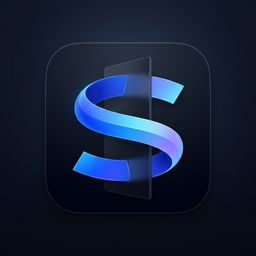
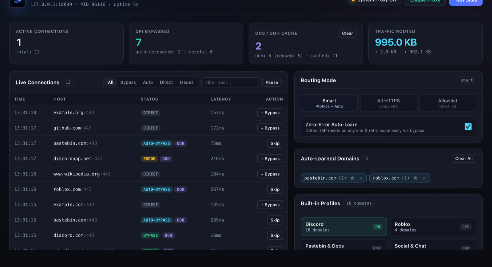

<p align="center">
  
</p>

<h1 align="center">Swerve</h1>

<p align="center">
  macOS için Rust ile yazılmış küçük ve hızlı bir DPI aşma proxy'si.<br/>
  Discord'u (ve engellenen diğer siteleri) VPN olmadan yeniden çalıştırır.
</p>

<p align="center">
  <a href="README.md">English</a> ·
  <a href="#kurulum">Kurulum</a> ·
  <a href="#kullanım">Kullanım</a> ·
  <a href="#nasıl-çalışır">Nasıl çalışır</a> ·
  <a href="#ayarlar">Ayarlar</a>
</p>

<p align="center">
  
</p>

---

## Bu ne?

Bazı internet sağlayıcıları Discord gibi siteleri **DPI (Derin Paket İnceleme)** ile engeller. Bilgisayarınız bir HTTPS bağlantısı açarken gönderdiği ilk pakette (TLS `ClientHello`) sitenin adı düz metin olarak durur (SNI alanı). Sağlayıcının ağındaki DPI cihazı bu adı okur, engelli listedeyse sahte bir TCP reset ile bağlantıyı keser. Tarayıcıda `ERR_CONNECTION_RESET` görmenizin, `curl`'ün 35 koduyla hata vermesinin sebebi bu.

Swerve Mac'inizde yerel bir proxy olarak çalışır (`127.0.0.1:18080`) ve kendini macOS sistem proxy'si olarak ayarlar. Engelli siteler için:

1. **Adı DNS-over-HTTPS ile çözer** (Cloudflare / Google, doğrudan IP üzerinden). Sağlayıcının zehirlenmiş DNS cevabı sizi ölü bir adrese yönlendiremez.
2. **`ClientHello`'yu yeniden şekillendirir.** Site adını birkaç TLS kaydına ve/veya çok küçük TCP parçalarına böler, DPI cihazı adı tek parça halinde okuyamaz. Gerçek sunucu parçaları sorunsuz birleştirir, aradaki basit desen eşleştirici ise birleştiremez.

Hiçbir şeyin şifresi çözülmez, sertifika yüklemeniz gerekmez, trafik ziyaret ettiğiniz site dışında hiçbir yere gitmez. **VPN değildir:** IP adresiniz aynı kalır, engelli olmayan siteler hiç dokunulmadan doğrudan gider.

### Öne çıkanlar

- **Otomatik öğrenen akıllı mod.** Açık profillerdeki sitelere bypass uygulanır. Listede *olmayan* bir site DPI tarafından kesilirse aynı istekte bypass ile tekrar denenir ve hatırlanır. Liste tutmanıza gerek kalmaz.
- **Birden fazla yöntem:** `combo` (varsayılan), `tls-record`, `chunk`, `sni-split`, istenirse düşük TTL'li sahte paketler. Ağınızda hangilerinin çalıştığını `swerve test --probe` söyler.
- **Dahili DoH çözücü:** saf Rust, kalıcı bağlantılar, TTL önbelleği.
- **macOS'a özel.** Proxy'yi tüm ağ servislerinde ayarlar (Wi-Fi, Ethernet, USB tethering, Tailscale), yerel/LAN/Tailscale adreslerini doğrudan bırakır, ağ değişikliklerini takip eder ve LaunchAgent olarak açılışta başlar.
- **Canlı web paneli** (`http://127.0.0.1:18080/ui`): bağlantı akışı, tek tıkla bypass/hariç tut, profil açma/kapama, yöntem ayarları ve bağlantı testi.
- **Hafif.** Tek ~3 MB dosya, ~15 MB RAM, CPU kullanımı neredeyse sıfır.

## Gereksinimler

- macOS (macOS 27, Apple Silicon üzerinde test edildi)
- Derlemek için Rust 1.85+ (`rustup` / `brew install rust`)
- Ağ ayarlarını değiştirebilen bir kullanıcı (herhangi bir yönetici hesabı)

## Kurulum

```bash
git clone https://github.com/yyamandevrim/swerve.git
cd swerve
cargo build --release
cp target/release/swerve ~/.cargo/bin/     # ya da $PATH'teki herhangi bir yer
swerve install
```

`swerve install` şunları yapar:

- `~/.config/swerve/config.toml` dosyasını oluşturur (Discord profili varsayılan olarak açık),
- `~/Library/LaunchAgents/dev.swerve.agent.plist` LaunchAgent'ını kurup başlatır (açılışta başlar, çökerse yeniden başlatılır),
- tüm ağ servislerinde HTTP + HTTPS sistem proxy'sini `127.0.0.1:18080` yapar; yerel, LAN ve Tailscale adresleri hariç tutulur.

Sonra **Discord'u tamamen kapatıp yeniden açın** (⌘Q), proxy'yi görsün. Bu kadar.

Çalıştığını kontrol edin:

```bash
swerve test
```

```
=== Direct proxy test (http://127.0.0.1:18080) ===
  https://discord.com            -> HTTP 200 (exit:0) (222ms)
  https://gateway.discord.gg     -> HTTP 404 (exit:0) (264ms)   # burada 404 normal
  ...
```

## Kullanım

### Günlük komutlar

| Komut | Ne yapar |
|---|---|
| `swerve status` | Servis durumu, canlı sayaçlar, mevcut macOS proxy ayarları |
| `swerve ui` | Web panelini açar |
| `swerve stop` | Sistem proxy'sini kapatır, servisi durdurur |
| `swerve start` | Servisi başlatır, sistem proxy'sini yeniden açar |
| `swerve restart` | LaunchAgent'ı yeniden kurar (dosyayı güncelledikten sonra) |
| `swerve test` | Discord'u ve birkaç siteyi proxy üzerinden test eder |
| `swerve test --url site.com` | Belirli siteleri test eder |
| `swerve test --probe` | Tüm yöntemleri ağınızda Discord'a karşı dener |
| `swerve uninstall` | Proxy'yi kapatır, LaunchAgent'ı kaldırır |

### Neyin bypass edileceğini seçmek

```bash
swerve mode smart          # profiller + kendi alan adlarınız + otomatik öğrenme (varsayılan)
swerve mode list           # sadece profiller + kendi alan adlarınız, öğrenme yok
swerve mode all            # tüm HTTPS sitelerine bypass

swerve profiles list
swerve profiles enable roblox
swerve profiles disable roblox

swerve domains add example.com        # her zaman bypass (alt alan adları dahil)
swerve domains remove example.com
swerve domains exclude bankam.com     # asla dokunma, hep doğrudan
swerve domains unexclude bankam.com
swerve domains list
```

Bu komutlar `config.toml`'u düzenler ve çalışan servisi anında yeniler, açık bağlantılar kopmaz.

Dahili profiller:

| Profil | Kapsam |
|---|---|
| `discord` | Discord uygulaması, gateway, CDN, medya, güncellemeler, ekler (varsayılan açık) |
| `roblox` | Roblox web, istemci, CDN |
| `pastebin` | Pastebin, Imgur, Wattpad |
| `social` | Instagram, X/Twitter, Telegram web, Reddit |
| `gaming` | Twitch, Kick, Steam Community |
| `dev` | Wikipedia, Archive.org, Medium, SoundCloud |

### Web paneli

`swerve ui` (ya da `http://127.0.0.1:18080/ui`):

- **Live Connections:** her bağlantı, nasıl yönlendirildiği (`DIRECT`, `BYPASS`, `AUTO-BYPASS`, `ERROR`), DoH kullanımı ve gecikmesiyle listelenir. Bir satırda **+ Bypass** o siteyi hep bypass eder, **Skip** hep doğrudan bırakır.
- **Routing mode** ve **auto-learn** anahtarı.
- **Auto-learned domains:** otomatik kurtarılan siteler. ★ ile ayarlara kalıcı ekleyin, × ile silin.
- **Profiller, motor ayarları** (yöntem, parça boyutu, sahte paketler), **DNS önbelleği**, **sistem proxy'si aç/kapa** ve **Test Sites**.

Swerve sadece `127.0.0.1`'i dinler; ayar değiştiren istekler `127.0.0.1` / `localhost` sayfasından gelmiyorsa reddedilir, yani başka siteler ayarlarınızı değiştiremez.

### Ön planda çalıştırmak

Hata ayıklamak için servisi durdurup terminalde çalıştırın:

```bash
swerve stop
swerve run --verbose --auto-proxy      # --auto-proxy: sistem proxy'sini açar, Ctrl-C ile kapatır
```

`swerve run` ayrıca `--listen`, `--mode`, `--strategy` ve `--chunk-size` alır.

## Nasıl çalışır

```
 Discord / tarayıcı ──CONNECT discord.com:443──▶ Swerve (127.0.0.1:18080)
                                                    │
                           site hariç mi? ──evet──▶ doğrudan, dokunulmadan
                                                    │ hayır
              profil / özel / öğrenilmiş eşleşme? ─hayır─▶ doğrudan ──DPI kesti mi?──evet──▶ bypass ile tekrar dene, siteyi hatırla
                                                    │ evet
                            DoH ile çöz (1.1.1.1, 1.0.0.1, 8.8.8.8)
                                                    │
                ClientHello'yu yeniden yaz (SNI'yi TLS kayıtlarına + küçük TCP parçalarına böl)
                                                    │
                                                    ▼
                                     discord.com  ◀── bağlantının geri kalanı bayt bayt aktarılır
```

Her bağlantıda sadece **ilk paket** değiştirilir. El sıkışmadan sonra Swerve şifreli baytları iki yöne aynen kopyalar.

### Yöntemler

| Yöntem | Ne yapar | Ne zaman |
|---|---|---|
| `combo` (varsayılan) | ClientHello'yu site adının tam ortasından iki TLS kaydına böler, sonra küçük TCP parçalarıyla gönderir | Çoğu sağlayıcıda çalışır |
| `tls-record` | Sadece TLS kaydı bölme | `combo` yavaşsa |
| `chunk` | Sadece küçük TCP parçaları (`chunk_size` bayt) | TLS kayıtlarını birleştiren DPI'da |
| `sni-split` | Site adının ortasından iki TCP segmenti | Basit DPI'da |
| `skip` | Değiştirmeden geçir | Hata ayıklama |

Varsayılan çalışmayı bırakırsa `swerve test --probe` çalıştırıp `OK` görünen bir yöntem seçin. İnatçı DPI için `fake_count = 1..3` ayarlayın: gerçek paketten önce düşük TTL'li sahte ClientHello'lar gönderilir, DPI cihazına ulaşırlar ama sunucuya varmadan ömürleri biter.

## Ayarlar

`~/.config/swerve/config.toml` ilk çalıştırmada oluşur. Düzenledikten sonra `swerve restart` ile, ya da yeniden başlatmadan `launchctl kill HUP gui/$(id -u)/dev.swerve.agent` ile yenileyin.

```toml
listen_addr = "127.0.0.1:18080"   # proxy, panel ve API adresi
mode = "smart"                    # smart | all | list
auto_learn = true                 # smart modda: DPI'ın kestiği siteleri tekrar dene ve hatırla
strategy = "combo"                # combo | tls-record | chunk | sni-split | skip
chunk_size = 2                    # chunk/combo için TCP parça boyutu, bayt (1–64)
chunk_delay_us = 0                # parçalar arası bekleme, µs (0 = yok)
fake_count = 0                    # gerçek paketten önce düşük TTL'li sahte ClientHello sayısı (0–5)
fake_ttl = 6                      # sahte paketlerin TTL'i: DPI'a yetecek kadar yüksek, sunucuya varmayacak kadar düşük
doh_for_matched = true            # bypass edilen siteleri DNS-over-HTTPS ile çöz
doh_servers = ["1.1.1.1", "1.0.0.1", "8.8.8.8"]
connect_timeout_ms = 8000
profiles = ["discord"]
domains = []                      # her zaman bypass listeniz
exclude_domains = ["apple.com", "icloud.com", "mzstatic.com", "tailscale.com", "ts.net"]
```

Alan adı kuralları alt alan adlarını da kapsar (`discord.com`, `cdn.discord.com`'u da kapsar).

Dosyalar:

| Yol | |
|---|---|
| `~/.config/swerve/config.toml` | ayarlar |
| `~/Library/LaunchAgents/dev.swerve.agent.plist` | LaunchAgent |
| `~/Library/Logs/swerve/swerve.err.log` | servis logu |

HTTP API için [İngilizce README](README.md#configuration)'ye bakın.

## Sorun giderme

**Discord hâlâ bağlanmıyor.** Tamamen kapatın (pencereyi kapatmak yetmez, ⌘Q) ve yeniden açın. Uygulamalar proxy ayarını açılırken okur. `swerve status` ile servisin çalıştığını ve proxy ayarlarında `HTTPSEnable : 1` olduğunu kontrol edin.

**Her şey çalışıyordu, Wi-Fi / VPN değişince bozuldu.** `swerve restart` çalıştırın. Swerve ağ değişikliklerini izler, ama temiz bir başlangıç proxy'yi tüm servislere yeniden uygular.

**Bir site Swerve yüzünden bozuldu.** `swerve domains exclude o-site.com` çalıştırın ya da panelde **Skip**'e basın.

**Bypass çalışmayı bıraktı.** Sağlayıcınız muhtemelen DPI'ını değiştirdi. `swerve test --probe` çalıştırıp `OK` görünen yönteme geçin (ayarlarda `strategy = "..."` ya da panelden).

**Normal internetimi hemen geri istiyorum.** `swerve stop`. Dosya silindiyse proxy'yi elle kapatın: Sistem Ayarları → Ağ → (bağlantınız) → Ayrıntılar → Proxy'ler → *Web proxy* ve *Güvenli web proxy*'yi kapatın.

## Kısıtlar

- **Sesli/görüntülü aramalar UDP kullanır, HTTP proxy bunu taşıyamaz.** Mesajlar, görseller, sunucular ve uygulamanın kendisi çalışır. Sesin çalışıp çalışmayacağı, sağlayıcınızın Discord'un ses sunucularını da engelleyip engellemediğine bağlı.
- **Sadece macOS sistem proxy'sine uyan uygulamalar** Swerve'den geçer. Tarayıcılar, Discord, Electron uygulamaları ve çoğu yerel uygulama uyar; bazı oyunlar ve terminal araçları uymaz (`curl` için `-x http://127.0.0.1:18080` kullanın).
- **Düz HTTP (port 80) aktarılır ama değiştirilmez.** Engelleme zaten neredeyse hep HTTPS üzerinde.
- **Bu bir gizlilik aracı değil.** Sağlayıcınız IP'nizin Discord'un IP'leriyle konuştuğunu yine görür. SNI yerine IP ile engelliyorlarsa VPN gerekir.

## Kaldırma

```bash
swerve uninstall                       # proxy'yi kapatır, LaunchAgent'ı kaldırır
rm ~/.cargo/bin/swerve
rm -rf ~/.config/swerve ~/Library/Logs/swerve
```

## Geliştirme

```bash
cargo test
cargo build --release
swerve restart          # yeni dosyayı yerine kopyaladıktan sonra
```

Kod yapısı için [İngilizce README](README.md#development)'ye bakın.

## Uyarı

Swerve sadece kendi trafiğinizin paketlenme biçimini değiştirir; şifrelemeyi kırmaz, normalde erişemeyeceğiniz bir şeye erişmez. Ağ filtrelerini aşmaya dair yasalar ülkeden ülkeye değişir. Kullanım sorumluluğu size aittir.

## Lisans

[MIT](LICENSE)
